# *You're strong... but I don't stop leveling up.*

**Windows internals & native APIs · secure desktop software · 3D on the web · automation**

---

## 👋 About

I build things from the ground up and ship them: a Windows tuning tool that can undo what it does, a self-updater that refuses
unsigned binaries, an expense app that works offline. I care about software that behaves on real machines, so most of what I
write comes with tests and an honest list of its limits.

**How I work:** I design, specify, test and verify; AI assistants (Claude Code) write much of the code. Every project below says so and
links its tests, so you can judge the result instead of taking my word for it.

## ⭐ Featured

<table>
<tr>
<td width="33%" valign="top">

### [Toji](https://github.com/ImSothe/Toji-Windows-Optimizer)
**Windows tuning tool, MIT.** 70 tweaks, each stored as data. Backups are written *before* every change and undone **LIFO**,
so overlapping tweaks cannot leave the system wrong (a real bug I found, reproduced and fixed). Signed auto-update,
hardened data folder, calibrated timer resolution.
 WPF · .NET 8 · P/Invoke · **172 tests, 87.5 % line coverage** (non-UI), verified apply/revert on a real PC

</td>
<td width="33%" valign="top">

### [SignedUpdater](https://github.com/ImSothe/SignedUpdater)
**Safe self-update from GitHub Releases.** ECDSA-signed manifest, streaming SHA-256 check under a size cap, host allow-list,
rollback-safe swap. Written up with its threat model **and its limits**.
 .NET 8 · security · 13 tests · MIT

</td>
<td width="33%" valign="top">

### [Finanzas](https://github.com/ImSothe/Finanzas) · [live](https://imsothe.github.io/Finanzas/)
**Expense PWA on your own Google Sheet.** Log an expense in 3 seconds, or photograph a receipt and let Gemini itemise it.
Offline queue with idempotent replay, hardened Apps Script backend.
 PWA · Apps Script · Gemini · **132 tests** · MIT

</td>
</tr>
</table>

## 🛠️ More work

| Project | What it is | Stack · proof |
|---|---|---|
| **[WindowsTimerResolution](https://github.com/ImSothe/WindowsTimerResolution)** | `NtSetTimerResolution` wrapper with explicit release and **auto-calibration**. Measured: `Sleep(1)` 15.6 ms → 1.5 ms held, 1.2 ms calibrated. Also documents what did *not* work. | .NET 8 · 13 tests · MIT |
| **[AD Hardware Inventory](https://github.com/ImSothe/AD-Hardware-Inventory)** | Agentless hardware inventory for a Windows domain in one read-only PowerShell script (AD list → parallel WinRM/CIM → CSV). Run in a real 26-computer domain; unreachable machines are reported, not dropped. | PowerShell · MIT |
| **[AI Hoodie Studio](https://github.com/ImSothe/AI-Hoodie-Studio)** | 3D hoodie configurator: place graphics on a 3D garment, pick the technique per piece, export a production dossier PDF. | Next.js 16 · three.js · Fabric.js · MIT |
| **[Industrial Web Template](https://github.com/ImSothe/Industrial-Web-Template)** | Sanitized B2B 3D configurator distilled from a real industrial project, with a hardened reference API (parameterized SQL, XSS/path-traversal defenses, lockout). | Three.js · GSAP · Node |
| **[sheetmetal-geometry](https://github.com/ImSothe/sheetmetal-geometry)** | Pure-JS sheet-metal maths: chained bends, K-factor allowance, flat patterns, boolean-merged cut outlines. | JS · 13 tests · MIT |
| **[Jarvis Project](https://github.com/ImSothe/Jarvis-Project-by-Sothe)** | Voice-driven personal AI assistant for Windows on the open-source [OpenJarvis](https://github.com/open-jarvis/OpenJarvis) framework: native app, local wake-word filter, a tool router that cuts tool-definition tokens per request by up to ~85 %. | Python · Gemini · Apache-2.0 base |

<b>Products built with a partner (code private, showcase only)</b>

 

| Project | What it is |
|---|---|
| **[APP ENTREGAS](https://github.com/ImSothe/APP-LOGISTICA-showcase)** | Delivery map for several companies: customer flags coloured by order state, courier PWA with routes ordered by real driving time, GPS checkpoints, offline queue, admin panel. Two-person project with [@TenMM2](https://github.com/TenMM2): I designed, specified and tested it (built with Claude Code); TenM built the dependency-free Node.js server and security. 66 tests. |
| **[Plantilla Taller](https://github.com/ImSothe/Plantilla-Taller-showcase)** | White-label platform for auto repair shops: public portal with plate lookup and booking calendar, owner approval of extra work, shop-floor panel with per-task timers and QR labels. Privacy by design, tested Firestore rules, 250 unit tests. Built with [@TenMM2](https://github.com/TenMM2); code private. |

---

**Want to talk about any of this? Reach me on [LinkedIn](https://www.linkedin.com/in/%C3%A1ngel-baz-monteiro-8196a21a9/).**

