# *You're strong... but I don't stop leveling up.*

 

 

  

## 👋 About

Systems & software builder. I like building from the ground up: Windows internals and native APIs on one side, 3D on the web on the other, and tying it together with automation. I ship things I actually use.

Shipping open-source tools in public — focused on high-performance Windows desktop apps, 3D on the web and AI automation. More coming as they're ready for other people to see.

## 🛠️ Projects

| | |
|---|---|
| **[Sothe Windows Optimizer](https://github.com/ImSothe/Sothe-Windows-Optimizer)** | A power-user Windows tuning tool: 70+ reversible tweaks, nothing hidden behind a "safe mode." WPF/.NET 8, `ntdll` P/Invoke for timer resolution, an ECDSA-signed auto-updater, and 212 automated tests. |
| **[AI Hoodie Studio](https://github.com/ImSothe/AI-Hoodie-Studio)** | A 3D hoodie configurator: place AI-generated or uploaded graphics on a 3D garment (three.js decals), pick the technique per piece (screen print, reflective ink, relief and tone-on-tone embroidery) and export a production dossier PDF with vector dimensions plus a numbered workshop order. Next.js 16, React 19, Fabric.js. Open source (MIT). |
| **[Industrial Web Template](https://github.com/ImSothe/Industrial-Web-Template)** | A sanitized, portfolio-ready B2B 3D configurator (Three.js + GSAP + polygon-clipping) distilled from a real industrial project, with a hardened reference API (parameterized SQL, XSS/path-traversal defenses, lockout policy). |
| **[WindowsTimerResolution](https://github.com/ImSothe/WindowsTimerResolution)** | A tiny .NET 8 wrapper over `NtSetTimerResolution` with explicit release. Measured here: `Sleep(1)` goes from 15.7 ms to 1.5 ms while held. Tested, MIT. |
| **[SignedUpdater](https://github.com/ImSothe/SignedUpdater)** | Safe self-update for desktop apps from GitHub Releases: ECDSA-signed manifest, streaming SHA-256 check, host allow-list and a rollback-safe swap. Written up with its threat model and limits. 13 tests, MIT. |
| **[sheetmetal-geometry](https://github.com/ImSothe/sheetmetal-geometry)** | Pure-JS sheet-metal maths: chained bends, K-factor allowance, flat-pattern layout and boolean-merged cut outlines (polygon-clipping). 13 tests, MIT. |
| **[Finanzas](https://github.com/ImSothe/Finanzas)** ([live app](https://imsothe.github.io/Finanzas/)) | A mobile-first PWA for personal expenses on top of your own Google Sheet: log an expense in 3 seconds with a habits dictionary that auto-picks the category, or photograph a receipt and let Gemini itemise it line by line to see exactly where each euro went (saved split by category or as one row with the full breakdown). Offline queue with idempotent replay, `.xlsx` import/export, a desktop "advanced mode", an investment portfolio, a hardened Apps Script backend and 136 automated tests (security ones included). Built with AI assistants; MIT. |
| **[Jarvis Project by Sothe](https://github.com/ImSothe/Jarvis-Project-by-Sothe)** | A voice-driven personal AI assistant for Windows, built on the open-source [OpenJarvis](https://github.com/open-jarvis/OpenJarvis) framework (Apache 2.0). My layer: a native desktop app, hands-free voice with a local wake-word filter that keeps unrelated audio off the cloud, Spotify / PC / OBS control, Instagram and X analytics, and a tool router that cuts the tool-definition tokens per request by up to ~85%. Runs free with a single Gemini key. |

## 📬 Contact

**[LinkedIn](https://www.linkedin.com/in/%C3%A1ngel-baz-monteiro-8196a21a9/)** · **[Email me](mailto:angelbazm@gmail.com)** · **[Instagram @SoySothe](https://www.instagram.com/soysothe)**

